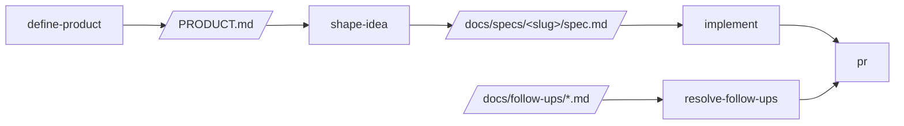

# Travel Buddy

> 출발 준비부터 여행지의 하루까지, 지금 챙겨야 할 것을 옆에 있는 친구처럼 먼저 알려 주는 여행 동반자 서비스.

2030 여행자, 특히 처음 가 보는 외국 도시를 여행하는 사람을 위한 웹앱입니다. 대표 장면은 **오사카 4박 5일** 여행입니다. 사용자가 일일이 찾아보지 않아도 서비스가 시간과 위치에 맞춰 "이거 필요해?" 하고 먼저 물어보고, 사용자는 확인만 누르면 됩니다.

[Claude Hunt](https://www.claude-hunt.com) 강의용 Claude Code Playbook 템플릿 위에서 만들었습니다.

## 주요 기능

### 여행 만들기와 코스
- 여행 날짜와 기간, 동행 유형, 취향(최대 3개)을 고르면 AI(Gemini)가 유명 명소 중심의 일차별 코스 초안을 짜 줍니다.
- 코스는 직접 고칠 수 있습니다. 순서·시각·장소를 편집하고 위치를 검색하며, 마음에 안 들면 다시 짜게 할 수 있습니다.
- 일차마다 동선 지도(Leaflet + OpenStreetMap)를 보여 주고, 장소를 누르면 구글지도 검색으로 열립니다.
- 내 여행 목록에서 여행 이름을 바꾸거나 지울 수 있고, 여행을 열 때는 비행기가 날아가는 출발 화면이 대기 시간을 덮습니다.

### 출발 전 준비
- 체크리스트로 여권·항공권·교통패스 같은 필수 항목을 챙깁니다. 항목은 직접 더하고 지울 수 있습니다.
- 서류 보관함에 사진이나 PDF를 올리면 체크리스트가 자동으로 채워집니다. 항공권·입장권은 인터넷이 약한 곳에서도 열리고, 여권은 본인만 볼 수 있습니다.
- 출발 전에 교통패스·입장권·할인권 구매를 권하는 제안이 뜹니다. 서비스가 직접 팔지 않고, 확인하면 마이리얼트립 검색 결과로 넘깁니다.

### 환율과 여비
- 엔화 총예산을 정하면 하루 권장액을 알려 주고, 빨리 쓸 때만 페이스 제안을 띄웁니다.
- 여비는 원화 환산액과 함께 일자별로 쌓이며, `#식비` 같은 카테고리나 `#닉네임` 태그로 걸러 볼 수 있습니다. 환율은 Frankfurter의 참고용 기준환율입니다.

### 필요한 순간의 제안
- 노선도 아래에 알림처럼 작은 제안이 뜹니다. 모든 제안은 사용자가 확인해야만 실행됩니다.
- 아침의 오늘 일정·날씨(Open-Meteo)·옷차림 안내, 저녁 정리, 다음 장소 길찾기, 주변 명소, 도착한 장소의 항공권·입장권 꺼내기, 여비 기록 권유가 있습니다.

### 함께 가는 사람
- 초대 링크(7일 유효)로 동행을 초대해 같은 일정을 함께 봅니다.
- 체크리스트는 각자 챙기고 여비는 합쳐서 기록합니다. 서류는 파일마다 공유 여부를 정하고, 코스와 예산은 여행 주인만 바꿉니다.

### 그 밖에
- 신규 회원에게 앱 소개(온보딩 투어)를 보여 주며, 내 여행 화면에서 다시 볼 수 있습니다.
- 마이페이지에서 이름과 프로필 사진을 정합니다.
- 화면은 2030에 맞춘 파스텔 글래스 테마입니다.

## 기술 스택

| 영역 | 사용 기술 |
|---|---|
| 프레임워크 | Next.js 16 (App Router) · React 19 · TypeScript |
| UI | Tailwind CSS 4 · shadcn/ui · Base UI · Remix Icon · Lucide |
| 백엔드 | Supabase (Auth, Postgres, Storage) · `@supabase/ssr` |
| AI | Google Gemini API (코스 초안 생성) |
| 지도 | Leaflet · OpenStreetMap 타일 · Nominatim 장소 검색 |
| 외부 데이터 | Open-Meteo(날씨) · Frankfurter(환율) |
| 도구 | Bun · Vitest · Testing Library · Playwright · ESLint |

## 시작하기

### 1. 의존성 설치

```bash
bun install
```

### 2. 환경 변수

프로젝트 루트에 `.env.local`을 만들고 아래 값을 채웁니다.

```bash
NEXT_PUBLIC_SUPABASE_URL=https://<project-ref>.supabase.co
NEXT_PUBLIC_SUPABASE_PUBLISHABLE_KEY=<publishable-key>
GEMINI_API_KEY=<gemini-api-key>
# 선택: 기본 모델 대신 쓸 Gemini 모델
GEMINI_MODEL=
```

### 3. 데이터베이스

스키마는 `supabase/migrations/`에 있습니다. Supabase CLI로 프로젝트를 연결한 뒤 마이그레이션을 적용합니다.

```bash
bunx supabase link --project-ref <project-ref>
bunx supabase db push
```

### 4. 개발 서버

```bash
bun dev
```

[http://localhost:3000](http://localhost:3000)에서 확인할 수 있습니다.

## 스크립트

| 명령어 | 설명 |
|---|---|
| `bun dev` | 개발 서버 실행 |
| `bun run build` | 프로덕션 빌드 |
| `bun start` | 프로덕션 서버 실행 |
| `bun run lint` | ESLint 실행 |
| `bun run typecheck` | `tsc --noEmit` 타입 검사 |
| `bun run test` | Vitest 단위·컴포넌트 테스트 1회 실행 |
| `bun run test:watch` | Vitest watch 모드 |
| `bun run test:e2e` | Playwright E2E 테스트 실행 |

## 프로젝트 구조

```
app/                라우트 (trips, trip, trip/day/[day], trip/documents, join/[token], mypage, auth)
features/           비즈니스 기능 단위 모듈
  ai-course/        AI 코스 초안
  briefing/         아침·저녁 안내
  budget/ expenses/ fx/   예산, 여비, 환율
  checklist/ documents/   체크리스트, 서류 보관함
  members/          동행 초대와 권한
  suggestions/ purchase/  상황별 제안, 구매 권유
  route-line/ weather/    상단 노선도, 날씨
  onboarding/       앱 소개 (steps.ts)
  auth/ profile/ trip/
components/         공용 UI (shadcn/ui)
lib/                Supabase 클라이언트 등 공용 유틸
supabase/           설정과 마이그레이션
docs/               스펙, 결정 기록, 후속 과제
e2e/                Playwright 테스트
```

코드는 기술 종류가 아니라 비즈니스 의미 단위로 묶고, 의존성은 `app` → `features` → `components`/`lib` 한 방향으로만 흐릅니다. 자세한 원칙은 [AGENTS.md](AGENTS.md)에 있습니다.

## 문서

- [PRODUCT.md](PRODUCT.md): 제품 정의, 핵심 루프, 경계
- [DESIGN.md](DESIGN.md): 화면 디자인 기준
- [GLOSSARY.md](GLOSSARY.md): 용어집
- [docs/specs/](docs/specs/): 기능별 스펙
- [docs/decisions/](docs/decisions/): 데이터 저장, LLM 연동, 테마 등 결정 기록
- [docs/follow-ups/](docs/follow-ups/): 남은 후속 과제

## 테스트

- **단위·컴포넌트**: Vitest + Testing Library. 테스트 파일은 소스 옆에 `*.test.ts(x)`로 둡니다. `globals`를 켜지 않았으므로 `describe`/`it`/`expect`는 `vitest`에서 import 합니다.
- **E2E**: Playwright. 테스트는 `e2e/*.spec.ts`에 두며, `webServer`가 `bun run dev`를 자동으로 띄웁니다. 처음 실행하기 전에 브라우저를 한 번 내려받습니다.

  ```bash
  bunx playwright install chromium
  ```

- **런타임 검증(에이전트용)**: 에이전트는 `next-dev-loop` 스킬과 [agent-browser](https://github.com/vercel-labs/agent-browser)로 실행 중인 앱을 직접 조작해 변경을 확인합니다.

## Claude Code 워크플로우



제품 방향은 `define-product`로 정하고, 기능은 `shape-idea`로 스펙을 만든 뒤 `implement`로 구현합니다. Git 작업은 `commit`, `pull`, `push`, `pr`, `merge`, `clean-branches` 스킬이 처리합니다.
